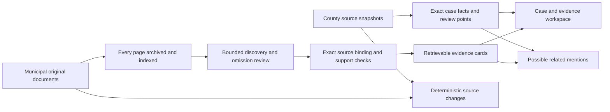

**Accepted Pass 0 design — September 6, 2026 (EDT)**

I recommend an official case inventory combined with independently searchable municipal evidence. The working research prototype now passes the frozen acceptance criteria on all development cohorts and a final untouched validation cohort. It delivers exact county facts, useful source excerpts, possible related mentions, and deterministic source-change events. This is a design I would carry forward into implementation, with its measured extraction limits kept visible.

The accepted artifact contains **8 county case cards, 176 municipal evidence cards, 28 original documents and 169 physical pages**. Its SQLite index contains all case cards, evidence cards and source pages. The implementation and raw experimental records are local; no production pipeline, API or UI was deployed.

[Accepted workspace](/home/jdaws/countyiq/output/pass0-redesign-2026-09-06/design-v111/accepted-workspace/workspace.json), [search database](/home/jdaws/countyiq/output/pass0-redesign-2026-09-06/design-v111/accepted-workspace/search.sqlite), and [acceptance receipt](/home/jdaws/countyiq/output/pass0-redesign-2026-09-06/design-v111/accepted-workspace/acceptance.json) preserve the reviewable result.

**The product contract starts with what each source establishes.** A county case card preserves every acquired attribute, including coded-use fields, notes and nulls, plus the original review-point geometry. Each value resolves to a JSON pointer in a hashed source response. A county receipt date establishes county review activity. It does not establish municipal approval, permit issuance or construction. The source point is not a parcel boundary or project footprint. Source OBJECTID identifies a source row; a repeated case number does not automatically merge rows or establish a shared project identity.

Municipal documents are discovered and read independently of those county cases. A policy amendment, sewer project, enforcement matter or capital expenditure can therefore appear even without a matching registry row. Each evidence card retains a literal source title and passages, the physical pages and offsets, original PDF, source hash, date metadata, and original header context. OCR-derived cards also expose crops from the original page image. The complete page archive remains searchable, including pages that produce no cards.

This supports concrete questions such as which named plans appeared on an agenda, what a source says about a bond request, and which property matters were discussed. For example, the validation card for Messiah Lifeways preserves the proposed approval and its conditions; its agenda framing remains visible. Groff Julius and Enbridge minutes retain motions and seconds without inventing an unrecorded vote. A short Fourth Street Alley agenda item establishes only that the named project was listed.



**The accepted extraction pipeline has four bounded model stages.** Discovery receives four primary pages with adjacent context, numbered source lines, and original page images for OCR inputs. An omission review examines every window, including windows whose first read found nothing. Deterministic binding resolves the returned ranges to the original text; wrapped titles are allowed, invalid ranges are rejected, and no rewritten facts enter the delivery.

A support check then sees the actual title and excerpt text alongside their positions and source context. It may retain or reject existing cards and passages. One final review revisits only rejections marked outside scope, clarifying substantial infrastructure work and named community-development funding. Wrong-subject and insufficient-context rejections are not reopened. This last stage cannot create a new candidate, invent a fact or repair source text. Its calls and rejected decisions remain in the cost and audit records.

The tested model was `openai/gpt-5.6-luna` through OpenRouter with OpenAI-only routing and no provider fallback. Discovery and omission review used low reasoning; support and scope review used high reasoning. All stages used an 8,192-token output cap and explicit per-call reservations. Frozen requests contain source inputs and prior candidate ranges, never reference labels, expected topic counts or primary evaluation judgments.

The workspace offers five lexical candidate links, including New Life House of Worship, Ruhlman and Fromm. They expose the matching municipality and shared title terms as their basis. They assign no property geometry, transfer no municipal decision and create no resolved project identity. Their recall as a linking system has not been established. Source-change fixtures distinguish a changed field, revised PDF and missing row; missing from an acquisition does not mean withdrawn. Repeated snapshots and duplicate PDF mirrors produce no new events.

**Acceptance criteria were frozen before the new experiments.** The minimums were 85% overall topic recall, 80% document-macro recall, 90% material-topic recall, 90% returned-card relevance, 95% source-semantic accuracy and 85% self-contained activity/state among covered topics. Additional requirements were zero observed critical errors, at most 10% duplicate cards, exact input accounting and source pointers, at least eight negative-control pages, zero alerts for unchanged or reordered inputs, and inference cost no higher than $0.005 per physical page. These thresholds were never lowered.

A topic receives recall credit only when a delivered card attaches evidence to the correct subject. Merely preserving the text somewhere in the page archive earns no recall credit. Material topics concern development, policy or capital work. Semantic review checks attribution, qualifications and proposed versus recorded activity; exact substring membership alone is insufficient. Full source review and card judgments were performed by the primary AI, with bounded acquisition help. These are qualified source judgments, not independent human gold or externally verified event truth.

| Cohort | Documents / pages | Topic recall | Material recall | Relevant cards | Inference $/page |
| --- | ---: | ---: | ---: | ---: | ---: |
| Original development | 9 / 123 | 76/85 — 89.4% | 61/66 — 92.4% | 98/99 — 99.0% | $0.00336 |
| First failed holdout, now development | 7 / 24 | 33/34 — 97.1% | 26/26 — 100% | 34/36 — 94.4% | $0.00185 |
| Second failed holdout, now development | 6 / 11 | 20/20 — 100% | 18/18 — 100% | 22/22 — 100% | $0.00200 |
| Final untouched validation | 6 / 11 | 19/19 — 100% | 14/14 — 100% | 19/19 — 100% | $0.00203 |

Document-macro recall was 90.8%, 96.7%, 100% and 100%, respectively. Self-contained coverage was 92.1% on original development and 100% on the other cohorts. All 176 delivered cards passed the qualified source-semantic review; zero critical errors were observed. Three cards were conservatively counted as duplicates, with the highest cohort fraction 2/22, or 9.1%. All 18 negative-control pages passed.

The final candidate was frozen at 01:58:34 UTC on September 7. Its six validation PDFs were previously unused. The primary read all eleven original pages and froze the reference before inference began. No candidate or reference changes followed those outputs. This was a purposeful, mostly-agenda sample; its perfect score is a small-sample result, not a population coverage estimate. The earlier failed holdouts are explicitly development data in the table.

[Frozen criteria](/home/jdaws/countyiq/output/pass0-redesign-2026-09-06/design-v111/acceptance.json), [candidate hashes](/home/jdaws/countyiq/output/pass0-redesign-2026-09-06/design-v111/candidate_v10_frozen.json), and [final validation evaluation](/home/jdaws/countyiq/output/pass0-redesign-2026-09-06/design-v111/validation-workspace/evaluation.json) record the thresholds, chronology and individual topic mappings.

**The failed iterations explain the final choices.** The first holdout initially recovered 28/34 topics: an arbitrary title-line limit discarded valid wrapped subjects. Removing that limit recovered the evidence, but the next cohort still failed because empty first reads skipped review and support checks rejected valid agenda or infrastructure items. Reviewing every window, providing literal excerpt text, and clarifying scope improved the design. A development regression still omitted substantial road-base work; the bounded scope review recovered qualifying cards. All failed outputs remain available. No missing card was manually restored in the accepted delivery.

The remaining misses are accepted limitations. Original development still misses nine topics, including grant administration, Act 537 legal expense, stone bins and park connectivity work. The first holdout misses a utility-rate report. Six covered development topics have thin financial context. Returned extras include routine pipe repair and a generic process overview. The design clears useful, realistic thresholds without representing those defects as solved.

**Mechanical verification passed independently of the semantic scores.** Checks resolved all 328 county field/geometry pointers and all 376 title/excerpt offsets, compared 83 original-image crops pixel-for-pixel, accounted for all 169 pages, and verified every one of the 353 search rows. The audit checked frozen request hashes, provider responses, actual cost receipts, complete review-window coverage and the final support/merge chains. Acquisition replay verified all nineteen newly acquired PDFs and their native text. A changed-field mutation was rejected; a single legitimate fixture change emitted one repeatable event, with no second event on unchanged replay.

Accepted inference across all stages used 153 calls costing **$0.501681**, or **$0.002969/page**. Including rejected iterations, this design experiment used 201 calls costing **$0.642386**; $0.140705 was outside the accepted pipeline. These figures exclude assistant evaluation labor, acquisition/OCR CPU, storage and operating infrastructure. The cumulative experiment ledger records $5.986950 known spend plus $1.079595 in earlier unsettled reservations, leaving $0.933455 unreserved under the existing $8 authorization. Earlier reservations were retained conservatively.

**The limits shape the implementation boundary.** Native PDF text can have incorrect reading order or omit graphical cancellation watermarks. OCR can corrupt a consequential line. Original images make such problems inspectable; they do not prove complete extraction. Source-kind classification is a narrow header-word heuristic, and upstream meeting-body metadata can be wrong. The original header must remain visible, and metadata alone cannot establish the deciding authority. No completeness claim extends beyond the acquired input set, and these fixtures do not establish live ingestion latency, publication coverage or notification reliability.

The next implementation should preserve these case, document, evidence and candidate-link boundaries and carry the acceptance corpus into regression checks. It should add operational acquisition manifests and source-change handling without promoting model-selected excerpts into automatic approval or construction fields. Forecasting and automatic imagery alerts remain outside the accepted core for the reasons measured in the [preceding experiment](/home/jdaws/countyiq/docs/research/pass0-combined-design-test.md). No human-review service is required by this design.

The checks below use saved source and response artifacts and make no paid API calls:

```bash
cd /home/jdaws/countyiq/pipelines
export PYTHONPATH="$PWD"
design_root=/home/jdaws/countyiq/output/pass0-redesign-2026-09-06/design-v111
.venv/bin/python "$design_root/audit_acquisition.py"
.venv/bin/python "$design_root/audit_final_pipeline.py"
.venv/bin/python "$design_root/audit_workspace.py" --workspace accepted-workspace
.venv/bin/python "$design_root/accept_final.py"
```

All four checks passed. Ruff lint and formatter checks passed for all 36 research Python files. The three new delegation records validated individually; whole-ledger validation still fails on a pre-existing line 9 missing `changed_files`. That unrelated historical record was preserved.
