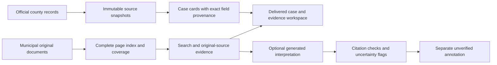

**Forecasting, imagery, and the combined evidence workflow — September 6, 2026**

The strongest tested foundation is an official case inventory plus complete original-source evidence. Historical data supports a modest forecasting experiment, but the model adds little beyond parcel size and its probabilities are poorly calibrated. Paired imagery is accessible and visually useful; the simple change detector failed. The combined workflow delivered exact official fields and searchable evidence, but generated summaries still missed topics and produced invalid citations. Nothing from this experiment was promoted into production municipal decisions or project identities.

| Experiment | Actual result | Decision |
| --- | --- | --- |
| Historical parcel forecast | On 172,059 held-out parcels, the top 1% contained 36 later review locations; acreage alone found 29. Model precision was 2.09%. | Keep as ranking research. No reliable construction forecast or usable probability estimate established. |
| Paired imagery | All 48 source images acquired. The fixed detector found 2 clear changes in its top 6 alerts, against qualified visual judgments. | Keep imagery as dated evidence; this detector is unsuitable for automatic alerts. |
| Official case inventory | Eight county cases retained, including four absent from the selected municipal document text. | Useful inventory gain from an additional source, not a model-recall improvement. |
| Combined broad summaries | Mentioned 20 of 23 checked topics; complete-PDF baseline mentioned all 23. | Generated synthesis is not ready to replace full-source discovery. |
| Deterministic delivery | Eight cards, 320 exact field values with source pointers, and 123 original pages; invalid generated citations rejected. | Viable source-fact and evidence layer. This does not establish correct automated municipal decisions. |

**Forecasting was tested with genuinely historical predictors.** The local test database had 175,928 parcels but only a September 2026 snapshot, which would not support this backtest. Three public [PASDA parcel archives](https://www.pasda.psu.edu/download/yorkcounty/historic/YorkCounty_Parcels/) were acquired and inspected. December 2018 and June 2020 contain different predictor values; January 2019 is an exact duplicate of the retained December feature values despite its different delivery date. Recorded delivery timestamps precede the evaluation windows. The archives contain use, acreage, building-age and appraisal fields. Sale dates include impossible or post-vintage values, so sales were excluded from the model.

The training panel uses December 2018 parcel attributes to predict whether a currently archived county review point has a received date during 2019 and lies inside that historical parcel. The test uses June 2020 attributes and points dated July 1, 2020 through June 30, 2021. This target is future **review-point activity**, not approval, permits, construction, every parcel involved in a project, or historical first-publication time. The outcome service was retrieved retrospectively; later corrections or backfills remain possible.

Training contains 171,120 eligible parcels and 222 positives. Testing contains 172,059 eligible parcels and 228 positives. All 18 rows sharing duplicate 2020 PIDNs were excluded. The 2019 source has 242 points but 240 distinct case IDs; those separate point rows and coordinates remain explicit, with no case-identity merge. Thirteen training-window points and two test-window points did not match a historical parcel. Both snapshots and outcome points use Pennsylvania South State Plane coordinates in US survey feet. Every retained feature value was checked against its original archived row, and 24 spaced positive assignments were independently decoded through the shapefile index and checked with local, read-only PostGIS.

A fixed categorical Naive Bayes model used municipality, property class, broad land-use code, acreage bins, presence of assessed improvements, and building-age bins. Features, smoothing and the top-1% review budget were frozen before fitting; there was no test-set tuning.

| Held-out metric | Model | Acreage alone |
| --- | ---: | ---: |
| Parcels reviewed | 1,721 | 1,721 |
| Later review locations found | 36 | 29 |
| Precision | 2.09% | 1.69% |
| Recall of positive parcels | 15.79% | 12.72% |
| Lift over county prevalence | 15.79× | 12.72× |
| ROC AUC | 0.8821 | 0.8789 |
| Average precision | 0.01317 | 0.01295 |

The model's raw-probability Brier score was 0.01418, versus 0.001323 for a constant training-prevalence prediction; lower is better. The ranking signal is real within this retrospective sample, but most is already present in acreage. Seven additional hits do not establish a statistically reliable model advantage. Roughly 98% of the top-ranked parcels had no matched future review point, and the model missed most positives. A single county and temporal holdout cannot establish generalization or probability calibration.

[Forecast results](/home/jdaws/countyiq/output/pass0-redesign-2026-09-06/viability-v109/forecast/evaluation.json), [source audit](/home/jdaws/countyiq/output/pass0-redesign-2026-09-06/viability-v109/forecast/source_audit.json), and [frozen protocol](/home/jdaws/countyiq/output/pass0-redesign-2026-09-06/viability-v109/forecast/model_protocol.json) preserve the experiment.

**Imagery access passed; the detector did not.** The sample was the first twelve county planning points, in case-number order, satisfying a preselected 2016–2018 development filter, plus twelve eastward comparison locations. Comparison locations were not presumed unchanged. Every site received a 2015 PASDA YCPC raster and a newer raster from the [PEMA county mosaic catalogue](https://www.pasda.psu.edu/uci/DataSummary.aspx?dataset=5161), whose captured metadata dates collection from December 2020 through March 2021. Exact per-pixel acquisition dates were not established.

All 24 pairs were acquired successfully at 512×512 pixels, totaling 23,119,539 downloaded bytes. Each box spans 256 EPSG:3857 map units, approximately 196 ground meters at these latitudes. The comparison offset is 500 map units, approximately 382–383 ground meters. The original manifest mislabeled map units as ground meters; the primary audit records the correction without modifying source images or coordinates.

The label-blind detector used local grayscale normalization, a fixed translation search and the mean of the largest 10% of pixel differences. Its six highest-ranked locations contained two clear structural changes and four apparent false alerts. Primary AI visual review identified ten clear changes, thirteen locations without clear structural change, and one ambiguous location. Against these qualified judgments, precision at six was 33%, recall was 20%, and rank AUC was 0.515. Random selection would average 2.5 clear changes in six sites. These are not independent human or surveyed labels, and this small, deliberately enriched sample is not a countywide accuracy estimate.

Fields, vegetation, shadows and brightness changes dominated several alerts. This result does not disprove trained change-detection models; none was trained here. It does rule out promoting this inexpensive detector. The six-year image interval also cannot establish when a change happened or provide a current construction status.

[Imagery results](/home/jdaws/countyiq/output/pass0-redesign-2026-09-06/viability-v109/imagery/evaluation.json), [source and coordinate audit](/home/jdaws/countyiq/output/pass0-redesign-2026-09-06/viability-v109/imagery/primary_audit.json), and [paired plan images](/home/jdaws/countyiq/output/pass0-redesign-2026-09-06/viability-v109/imagery/contact_sheets/plan.png) preserve the evidence.

**The combined test used a fresh, mixed-document cohort.** Nine July–August 2026 PDFs from Newberry, Heidelberg and Hopewell contain 123 physical pages, including 106 requiring OCR. The long reports packets contain 43 and 44 pages; financial pages and short reports were retained. Six case questions, three broad municipal questions and two negative questions were frozen from registry and document metadata before reading the municipal source bodies. The later evaluation reference was primary AI source review, not independent human gold.

The pipeline acquired the original PDFs, preserved hashes, extracted native text or OCR with physical-page provenance, and indexed every page. A separate, date-and-municipality query of the existing [county planning service](https://arcweb1.ycpc.org/server/rest/services/OPEN_DATA/PLANNING_Subdivisions/FeatureServer/0) returned eight July–August cases, reconciled against an independent count query. Case and negative questions used fixed lexical retrieval of up to six full pages; broad questions received every page for that municipality. County records remained separate from municipal evidence. The source feed is already configured in CountyIQ; the design change is to use its records as an explicit primary case inventory.

Nine complete native-PDF reads formed the baseline. Eleven registry-and-evidence questions used the same Luna model, low reasoning setting, provider restriction and output cap. The tasks, prompts and modalities deliberately differ, so the comparison measures this system design rather than an isolated model or prompt effect. All twenty calls completed without retries or provider fallback.

The four additional registry cases were William T. Stanley, Schwertzler & Amspacher, Zahn Partners and L. Dean and Maureen F. Fromm. Their absence from the selected municipal texts is not an extraction failure. In particular, Hopewell's only supplied municipal minutes are dated July 2, before its late-July and August county cases. The cohort does not represent every publication or meeting during the two-month period, and September retrieval does not prove August-cutoff public availability.

All six targeted answers described supported basic proposal types and left municipal approval unknown. That is useful, but not six flawless answers. The Stanley answer used the future-church note correctly without surfacing the mobile-home-use flag alongside it. The New Life answer attached the municipal street without explicitly qualifying its name-based candidate link. The Zahn answer inferred one new building from building-area and building-lot fields that do not explicitly state building count. Both negative answers returned `insufficient_evidence`, but began their prose with “No.” before explaining that the real outcome remained unknown.

The broad summaries mentioned 20 of the 23 preselected audit topics. They omitted Cly Road Sewer Extension, SolAmerica decommissioning security, and the 3703 Cherry Court septic-permit complaint. The complete-PDF baseline mentioned all 23. This is sentinel coverage, not an exhaustive recall estimate. The baseline returned 80 document-level records, including repeat subjects across documents and several routine equipment/procurement extras.

Citation checks also exposed substantive defects: the Newberry summary cited page 4 for a carried motion on page 5; the Heidelberg summary cited page 1 for an engineer comment on page 2; and it quoted our experiment coverage metadata as though it appeared on three original agenda pages. Many other nonliteral quotes were less consequential regroupings of JSON fields or excerpts joined with ellipses. Ten of eleven generated answers failed the strict literal-quote check; that is not a claim that ten answers were wholly false. The single answer passing that check still had unverified semantics.

Original-image inspection found a separate acquisition issue: Hopewell page 3 clearly records the CDBG opt-in motion passing, but OCR corrupted the relevant line. The query correctly abstained on the damaged text. Preserving and indexing every page therefore does not prove preservation of every readable statement. Original-page fallback needs explicit implementation and testing before relying on OCR-derived answers.

[Semantic findings](/home/jdaws/countyiq/output/pass0-redesign-2026-09-06/combined-v110/semantic_review.json) contain the source-backed issues and all 23 topic mappings. [The structural audit](/home/jdaws/countyiq/output/pass0-redesign-2026-09-06/combined-v110/audit.json) verifies source hashes, complete PDF payloads, exact query evidence, schema compliance, provider responses, and replayed retrieval.

**The end-to-end design should keep source facts authoritative.** Its tested core is:

The final local delivery artifact contains eight official cards with 320 field values, each independently resolved to a JSON pointer in the hashed original response. It preserves both coded-use fields and notes. It also contains every original page, its source URL/PDF, hash, transcription method and coverage information. The eleven query bundles retain their source evidence and citation-check results. Invalid generated quotations are rejected; generated prose never overwrites official fields, creates a municipal decision, or merges project identities. The guarded delivery reproduced byte-for-byte.

This is a working research implementation of source acquisition through delivery, not a deployed API or UI, and not a complete municipal-decision extractor. Keeping decision fields empty is an explicit limit of the prototype, not evidence that decision extraction has been solved. No human-review service is required or proposed as the product.

The resulting implementation direction is:

1. Expose the existing official review feed as source-native cases, preserving record IDs, coded attributes, notes, geometry, received dates and observation times. Keep municipality and source jurisdiction explicit.
2. Retain complete document originals and versioned page/paragraph evidence alongside those cases. Preserve the independent search route for policies, infrastructure, disputes and other matters without county case IDs.
3. Represent cross-source matches as candidates unless shared identifiers or sufficiently specific evidence support them. Keep county receipt, proposed use, municipal action and construction observations separate.
4. Generate source-change alerts from new or changed official records and document versions, with exact field deltas or source passages. Scheduling, live alert delivery and longitudinal update behavior were not exercised in this static test.
5. Use original-page reading when OCR quality prevents an answer; validate references as source positions or structured field pointers. Broad synthesis needs a completeness strategy beyond a single summary call. These improvements remain to be tested.
6. Keep forecast scores and imagery detection in separate research outputs until they demonstrate value beyond simple baselines and obtain suitable time-specific validation. Neither supplies authoritative case facts in this prototype.

The tested delivery is [delivery.json](/home/jdaws/countyiq/output/pass0-redesign-2026-09-06/combined-v110/delivery.json); its [delivery audit](/home/jdaws/countyiq/output/pass0-redesign-2026-09-06/combined-v110/delivery_audit.json) states the narrow guarantees and limitations.

**Validation and cost.** Archive and dataset manifests passed. Every retained historical feature was checked against its source; independent PostGIS samples and geometry fixtures passed. Forecast metrics fixtures and full model/prediction replay passed. Imagery ranks reproduced byte-for-byte. All fixed document retrievals and the final delivery reproduced. All experiment helpers pass the project formatter; the primary maintained helpers pass focused Ruff lint. Three lint findings remain in two hash-bound archive/dataset scripts: import spacing and date-only parsing without a timezone. These do not alter the recorded outputs. The two new delegation ledger entries validate individually; the repository-wide ledger commands still fail on the pre-existing line 9 missing `changed_files`.

The combined trial cost **$0.14933035**: $0.11379655 for nine full-PDF reads and $0.03553380 for eleven questions. Forecasting and imagery made no paid model calls. The cumulative $8 API authorization has $1.57584082 remaining after known charges and the earlier unresolved reservations. These costs exclude assistant work, CPU, storage and production ingestion overhead; the differing workloads are not a general production cost ratio. Research artifacts and this report were added; production application behavior was not changed.
